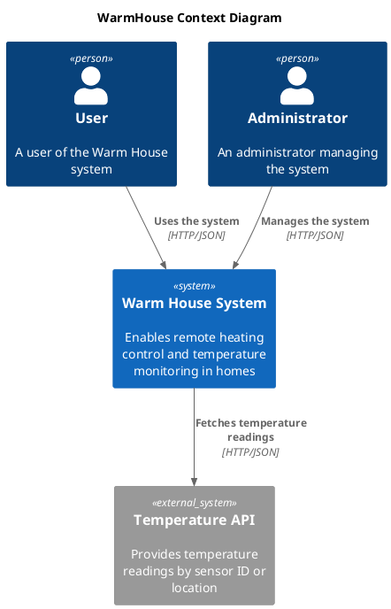
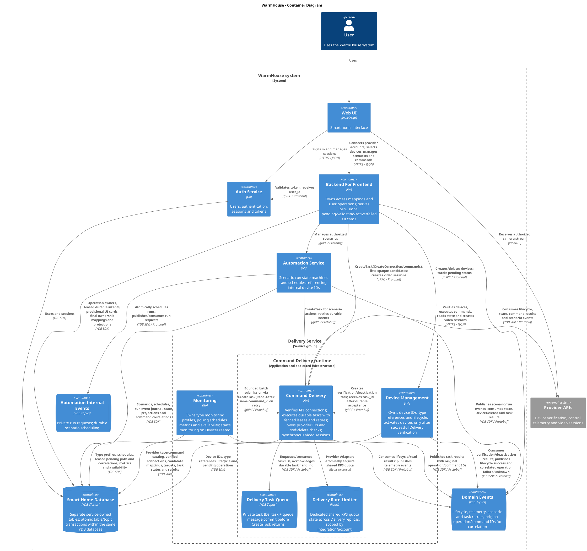
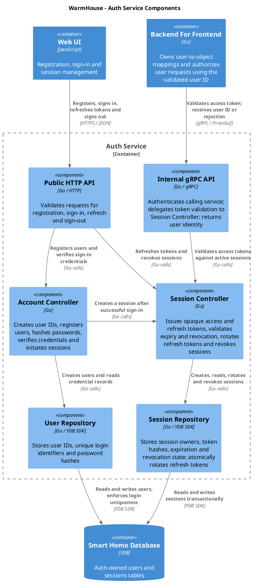
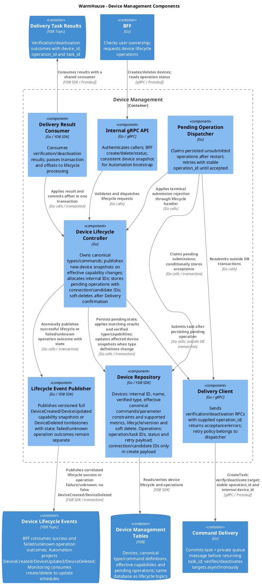
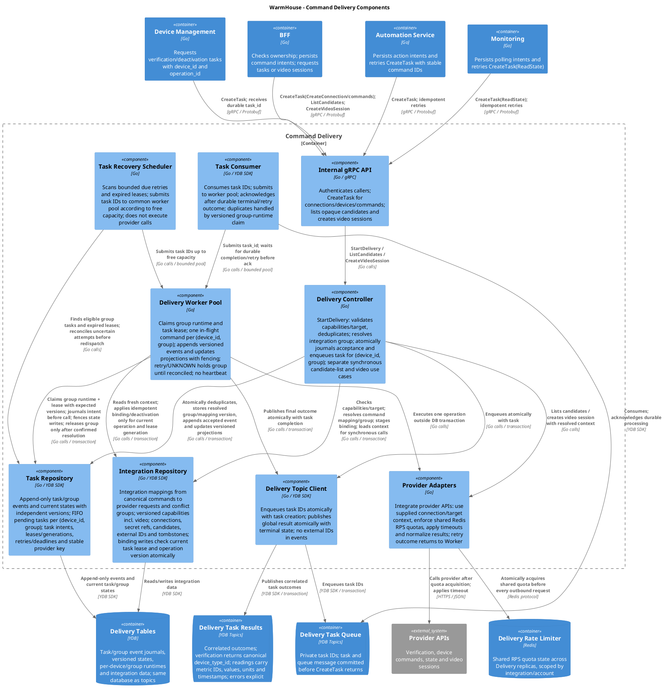
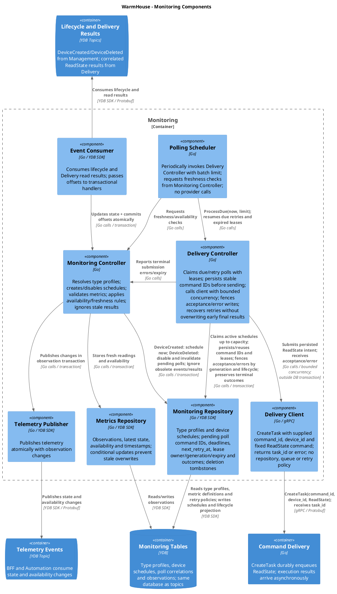
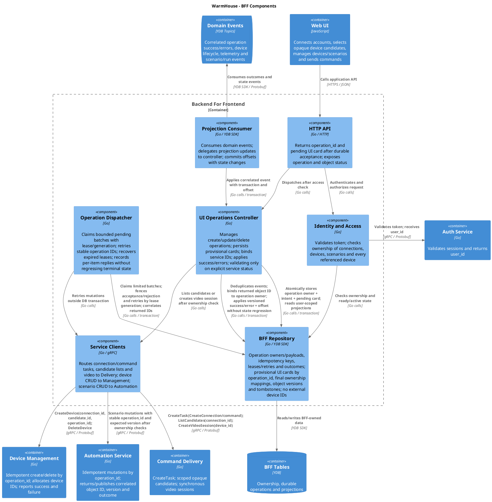
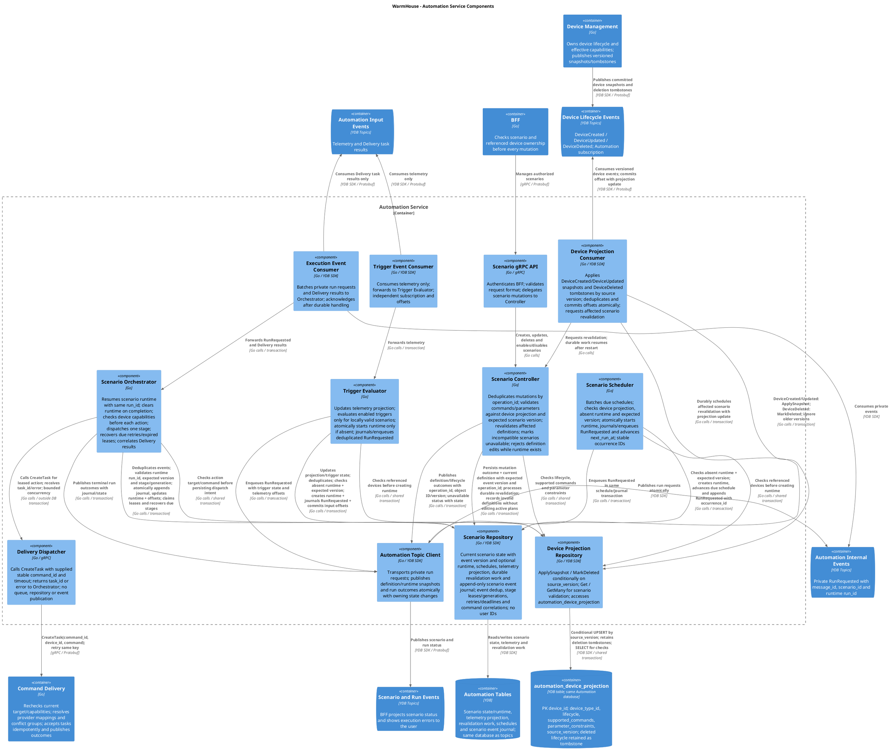
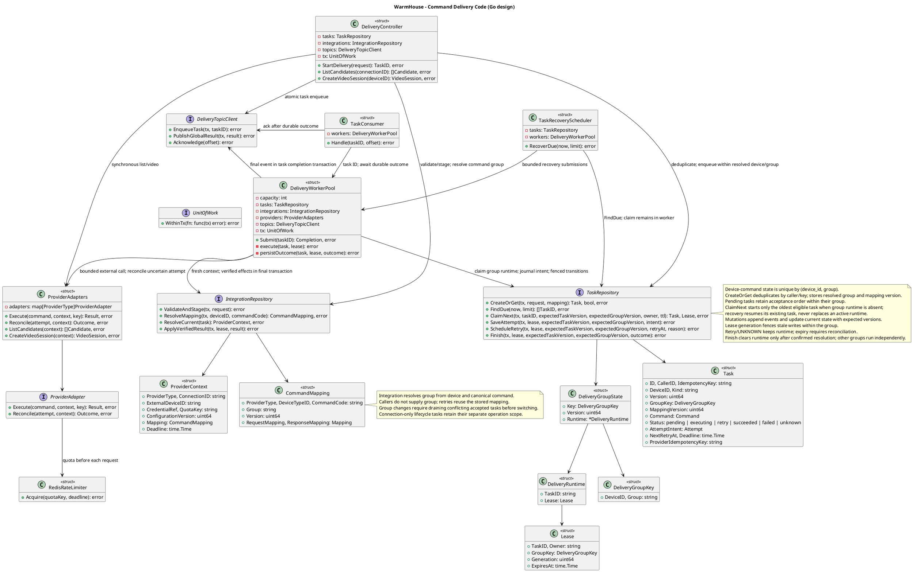
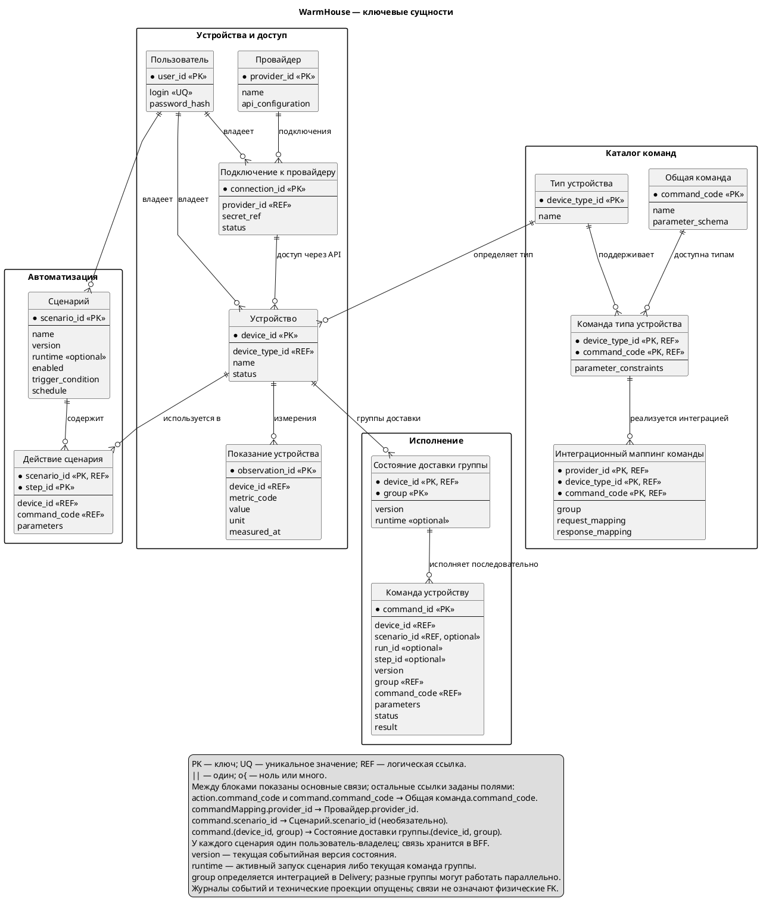

# Project_template

# Задание 1. Анализ и планирование

### 1. Описание функциональности монолитного приложения

По условию система обеспечивает включение/выключение отопления и просмотр температуры. Предоставленный код реализует учёт датчиков и получение температурных показаний. Изменение значения и статуса датчика затрагивает только запись в PostgreSQL; отправка управляющих команд оборудованию отсутствует.

**Границы анализа и принятые допущения**

Описание системы в задании и предоставленная реализация не полностью соответствуют друг другу. В условии заявлено управление отоплением, однако код содержит операции чтения показаний и изменения записей о датчиках в PostgreSQL без отправки команд оборудованию. Поэтому ниже различаются факты, подтверждённые кодом, и допущения для архитектурного анализа.

- **Подтверждено кодом:** монолит запрашивает показания у внешнего temperature API. Операции изменения значения и статуса датчика обновляют только БД.
- **Управление температурой не реализовано:** введённые через API значения сохраняются в PostgreSQL и читаются обработчиками GET, но не используются для регулирования отопления. При обновлении записи команды или целевые значения во внешнюю систему не передаются. Фоновой логики, которая читает эти значения и управляет оборудованием, в коде нет.
- **Ручное изменение данных вместо управления оборудованием:** API позволяет вручную менять значение и статус записи о датчике. . Модель не разделяет измеренную и целевую температуру; при успешном запросе к внешнему temperature API сохранённые значения подменяются его показаниями в ответе GET. 
- **Подтверждено кодом:** аутентификация, авторизация и разграничение доступа по ролям отсутствуют. Все зарегистрированные маршруты доступны любому клиенту, имеющему сетевой доступ к HTTP-серверу. Фактическая доступность из интернета зависит от конфигурации развёртывания и по коду не устанавливается.
- **Допущение о назначении API:** конечному пользователю предназначены только явно описанные в задании сценарии — включение/выключение отопления и просмотр температуры. Остальные операции считаю административными или интеграционными: учёт и изменение записей о датчиках — для администраторов, чтение и обновление данных в рамках возможных интеграций — для внешних сервисов. Наличие таких интеграций кодом не подтверждено. Точное соответствие пользовательских сценариев конкретным endpoint в условии не задано; изменение записи в БД само по себе не считается подтверждённой командой оборудованию.

Такое распределение доступа принято для анализа и проектирования; в текущем коде оно не обеспечивается. Фактические права вызывающих сторон и наличие внешней управляющей автоматики неизвестны.

**Управление отоплением:**

- По условию пользователь должен иметь возможность включать и выключать отопление.
- В предоставленном коде отправка команд оборудованию отсутствует: изменение `value` и `status` обновляет только запись в БД.
- Регулирование температуры и автоматическое поддержание заданного значения не реализованы. Доступно ручное изменение данных о датчике, но не подтверждённое управление физическим устройством.

**Мониторинг температуры:**

- API предоставляет список датчиков и сведения об отдельном датчике из БД.
- Для температурных датчиков при чтении выполняется синхронный запрос показаний во внешний API; при успехе они подставляются в ответ без сохранения в БД, при ошибке возвращаются данные из БД.
- Температуру по локации можно запросить напрямую у внешнего API через монолит. Фонового опроса и автоматических обновлений для клиента в коде нет.

### 2. Анализ архитектуры монолитного приложения

Перечислите здесь основные особенности текущего приложения: какой язык программирования используется, какая база данных, как организовано взаимодействие между компонентами и так далее.
Язык Go, БД Postgresql, есть внешнее api  - через которое запрашиваются данные по температуре. Внешнее api, по-видимому, сейчас само пулит данные по датчику (в задании написано управление от сервера к датчику, мутирующих запросов на apps/smart_home/services/temperature_service.go я не нашел).
Как создается датчик для меня загадка, так как в `CreateSensor` нет передачи идентификатора, в базе location не unique, вероятно внешняя система может мапить их по локации (но в базе локация не unique)

### 3. Определение доменов и границы контекстов

Предметная область системы по условию — управление умным домом. В текущей реализации представлены две функциональные области: учёт датчиков и получение температурных показаний.

#### 1. Учёт датчиков

- Добавление записи о температурном датчике.
- Изменение данных датчика.
- Удаление записи о датчике.
- Просмотр списка датчиков и сведений об отдельном датчике.

Эта область отвечает за сведения о датчиках, хранящиеся в БД монолита. Добавление или удаление записи не означает регистрацию или отключение физического устройства во внешней системе.

#### 2. Мониторинг температуры в помещениях

- Получение текущей температуры через внешний API по идентификатору датчика или локации.
- Подстановка полученных показаний в ответ при просмотре температурных датчиков.

### **4. Проблемы монолитного решения**
- В GetTemperatureByLocation почему-то нет похода в базу, все данные, включая локацию и описание, берутся из внешнего API. Смешаны домены учёта датчиков и получения показаний, не ясно кто отвечает за данные датчика.
- Заявленное в условии управление отоплением не реализовано: обновление значения и статуса меняет только БД, не отправляет команды оборудованию и не запускает регулирование температуры.
- Отсутвует слой бизнес логики, все смешано в хендлерах 
- Завязка на конкретные реализации PostgreSQL, API датчиков (Backing Services)
- Текущий endpoint GetTemperatureByLocation достанет только один датчик
- Не ясно как создаются дачтики, идентификатор создается в базе, при этом сами датчики не создаются во внешней api и он не заполняется (судя по контракту apps/smart_home/models/SensorCreate), как тогда работает GetTemperatureByID, либо оно работает так же по polling и датчик себе записывает идентификатор по локации (тогда проблема  тем что на локации реально один датчик)
- Получение актуальной температуры синхронно зависит от доступности внешнего API. При чтении списка или отдельного датчика ошибка внешнего API приводит к возврату сохранённых в PostgreSQL, потенциально устаревших данных; при запросе температуры по локации — к HTTP 500. Успешно полученные показания подставляются в ответ, но не сохраняются в БД. Чтобы отделить обработку пользовательских запросов от доступности внешнего API, можно вынести опрос в отдельный процесс, сохранять показания и отдавать их из БД с указанием времени измерения и актуальности. Это позволит читать последние сохранённые показания при сбоях внешнего API, но не обеспечит получение свежих данных во время его недоступности.
- При получении списка происходит последовательный fetch запросов (с таймаутом в 10 секун) по устройствам при 100 приборах это может при недосутпаности внешнего api привести к ожиданию порядка 1000 секунд, при чем которые никак не обрабатывают отмену клиентского запроса (будет просто висеть в background на polling).
- Запросы к базе идут без внешнего context handler'а, а заменяются background, что так же не обрывает запрос к базе в случае отмены на клиенте.
- Отсутствует модель управления доступами пользователей, ни авторизации, ни пользовательской таблицы в нем нет. В предоставленном коде все операции работают с общей таблицей датчиков, по всей видимости, пользователи могут получать и управлять чужими данными.

### 5. Визуализация контекста системы — диаграмма С4


# Задание 2. Проектирование микросервисной архитектуры

В этом задании вам нужно предоставить только диаграммы в модели C4. Мы не просим вас отдельно описывать получившиеся микросервисы и то, как вы определили взаимодействия между компонентами To-Be системы. Если вы правильно подготовите диаграммы C4, они и так это покажут.

**Диаграмма контейнеров (Containers)**



**Диаграмма компонентов (Components)**

### Auth Service



### Device Management



### Command Delivery



### Monitoring



Polling Scheduler только инициирует обработку очередной пачки. Delivery Controller выбирает активные расписания, сохраняет намерение опроса и lease до RPC, вызывает Delivery Client вне транзакции и сохраняет принятие/ошибку с проверкой поколения lease и актуальности расписания. Повтор использует прежний `command_id`; ранний финальный результат не перезаписывается ответом о принятии. Delivery Client — простой gRPC-клиент: отправляет фиксированную команду `ReadState` и возвращает `task_id` или ошибку, без собственной политики повторов и хранения состояния.

Monitoring Controller обрабатывает события создания/удаления устройств и результаты опросов. Отдельной проекции устройств нет: версия lifecycle и отметка удаления хранятся в записи расписания для защиты от старых событий. Удаление отключает расписание и инвалидирует ожидаемые опросы; поздний результат не возобновляет опрос и не меняет текущие показания удалённого устройства. Таймаут чтения обрабатывается как недоступность с повторами, а не как удаление устройства. Группу исполнения и интеграционный маппинг команды определяет Delivery.


**Backend For Frontend**



**Automation Service**



Проекция устройств в Automation отделена от проекции телеметрии для триггеров. Таблица `automation_device_projection` явно показана на L3 как локальная таблица Automation в той же YDB database, а не отдельная база или сервис. Её обновляет Device Projection Consumer через Device Projection Repository: создание/обновление вызывает `ApplySnapshot`, удаление — `MarkDeleted`; запись принимается только при более новой `source_version`. Consumer фиксирует обновление, задание перепроверки и offset одной транзакцией. Controller, Trigger Evaluator, Scheduler и Orchestrator читают таблицу через этот repository. Device Management владеет общими определениями типов и команд и публикует полные снимки `DeviceCreated`/`DeviceUpdated`: `device_id`, `device_type_id`, состояние жизненного цикла, фактически поддерживаемые общие команды, ограничения параметров и монотонную версию устройства. Изменение общих определений, влияющее на возможности устройства, приводит к публикации нового снимка устройства. `DeviceDeleted` сохраняется как tombstone: позднее событие не восстанавливает удалённое устройство. Версия источника не смешивается с событийной версией сценария. Группы конфликтов, внешние идентификаторы и преобразования API провайдера остаются в Delivery; владение и проверка пользовательского доступа — в BFF.

Consumer атомарно обновляет проекцию, сохраняет offset и создаёт долговечное задание перепроверки затронутых сценариев. Controller обрабатывает такие задания с восстановлением после перезапуска и помечает несовместимые определения недоступными. Проверка проекции выполняется при сохранении/включении сценария, создании runtime и перед сохранением намерения отправить очередное действие, в общей транзакции с соответствующим изменением состояния сценария. Уже отправленная команда не отменяется изменением проекции; её результат обрабатывается по прежнему `command_id`. Отсутствующий или удалённый объект и неподдерживаемая команда не допускаются к отправке; активный runtime завершается с соответствующей ошибкой, если следующее действие стало недопустимым. Изменение доступности сценария не переписывает его выполняемое определение.

Проекция является eventual consistent: Delivery проверяет актуальные возможности повторно перед исполнением. Первоначальное заполнение и восстановление требуют согласованного снимка Device Management с позицией продолжения потока либо полного воспроизведения сохранённых событий; до заполнения необходимой записи действия для устройства не допускаются. Эти правила относятся к проектируемому контракту событий, а не к уже реализованному API.

Delivery Dispatcher — обычный синхронный вызов CreateTask с таймаутом: возвращает task_id или ошибку. Он не читает и не пишет очереди. Orchestrator сохраняет намерение и lease до вызова, а принятие/ошибку после вызова — с проверкой lease generation. Восстановление использует тот же command_id; ранний итог Delivery не перезаписывается подтверждением принятия. Приватный топик Automation переносит RunRequested, журнал сохраняет все переходы state machine.

**Диаграмма кода (Code)**

### Command Delivery

Проектируемая структура Go-кода (C4 L4), а не описание уже реализованного сервиса. Сигнатуры сокращены: `context.Context`, типы транспортных DTO и детали реализации опущены. Зависимости показаны стрелками либо типами полей структур.



# Задание 3. Разработка ER-диаграммы

Диаграмма отражает ключевые сущности целевой системы, основные атрибуты и кратность связей. Технические сущности обработки задач и хранения проекций опущены.



Общие определения команд, схемы параметров и поддержка команд типами устройств принадлежат Device Management. Ограничения типа уточняют общую схему параметров. Delivery владеет интеграционными маппингами: для сочетания провайдера, типа устройства и общей команды задаёт преобразование запроса/ответа и группу конфликтов. Automation хранит в действии `device_id`, `command_code` и параметры; группу не передаёт. Delivery определяет её при принятии команды и сохраняет в запросе. Изменение маппинга не должно разделять старые и новые конфликтующие запросы на независимые группы: изменение групп требует согласованного переключения после завершения уже принятых конфликтующих команд.

Состояние доставки хранится по ключу `(device_id, group)` и обновляется с проверкой событийной `version`. Его `runtime` содержит текущую команду. Каждый запрос сохраняет собственный `command_id` для дедупликации и корреляции; ожидающие запросы не перезаписывают runtime занятой группы. Очерёдность внутри группы сохраняется, но технические позиции очереди на обзорной ER не показаны. При неизвестном исходе текущей команды группа остаётся занятой до сверки. Параллелизм между группами допустим в пределах ограничений интеграции.

`runtime` сценария содержит единственный активный запуск и очищается при завершении. Поля `scenario_id`, `run_id` и `step_id` у сценарной команды сохраняют связь с её происхождением после очистки runtime; у самостоятельного запроса они отсутствуют. Версии сценария, состояния доставки и отдельного запроса независимы. Append-only являются журналы событий, а не записи текущего состояния. Владение пользователем хранится в BFF, привязка устройства к подключению и внешний идентификатор — в Delivery; связи на диаграмме логические. Технические проекции Automation на этой ER не показаны.


# Задание 4. Создание и документирование API

### 1. Тип API

В целевой системе используются три вида взаимодействия:

- **HTTPS / JSON для Web UI → Auth и BFF.** Пользовательские операции описаны в OpenAPI: регистрация и сессии, подключения, устройства, сценарии, команды и просмотр состояния. BFF проверяет владение объектами и всеми устройствами, указанными в сценарии.
- **gRPC / Protobuf для синхронных вызовов между сервисами.** Типизированные контракты описывают проверку токена, изменение устройств/сценариев, принятие задачи Delivery, получение кандидатов и создание видеосессии. Ответ о принятии задачи не означает, что устройство уже выполнило команду.
- **Асинхронные события через YDB Topics.** Результаты команд, изменения устройств и сценариев, показания доставляются подписчикам независимо от исходного запроса. Контракты событий описаны в AsyncAPI, формат передачи — Protobuf. Monitoring получает события и отправляет фиксированную команду `read_state`; отдельного входящего прикладного RPC у него нет.

Такое разделение позволяет завершать HTTP-запрос после долговечного принятия операции, не ожидая внешнего провайдера. BFF возвращает `202` и `operation_id`; пользователь получает результат через статус операции и проекции объектов. Повтор запроса использует прежний ключ идемпотентности. Конкурентные изменения проверяют ожидаемую событийную версию. Delivery самостоятельно определяет группу команды по интеграционному маппингу и последовательно исполняет запросы внутри `(device_id, group)`.

### 2. Документация API


| Контракт | Документация |
|---|---|
| Auth: регистрация, вход, обновление токена, выход | [OpenAPI Auth](api/auth.openapi.json) |
| BFF: пользовательские операции, состояния объектов и показания | [OpenAPI BFF](api/bff.openapi.json) |
| Auth, Device Management, Automation, Command Delivery: внутренние RPC | [Protobuf services](api/services.proto) |
| События Device Management, Delivery, Monitoring и Automation | [AsyncAPI](api/events.asyncapi.json) |
| Формат событий для YDB Topics | [Protobuf events](api/events.proto) |
| Ответственность сервисов, авторизация, ошибки, версии и примеры взаимодействия | [Описание контрактов](api/README.md) |

Все события используют единый `FactMessage`: идентификатор, времена возникновения/записи, корреляция и причина, необязательные данные сущности и типизированный `oneof payload`. В метаданных сообщения YDB передаются `producer`, `payload_type` и `schema_version`, чтобы подписчики отбрасывали ненужные типы до декодирования тела.

OpenAPI описывает HTTP-интерфейсы; внутренние gRPC-вызовы документированы отдельно в Protobuf. AsyncAPI покрывает событийные интерфейсы микросервисов, включая Monitoring. В спецификациях предусмотрены примеры запросов и событий, состояния `pending/succeeded/failed/unknown` и корреляция `operation_id/command_id/run_id`.

# Задание 5. Работа с docker и docker-compose

Перейдите в apps.

Там находится приложение-монолит для работы с датчиками температуры. В README.md описано как запустить решение.

Вам нужно:

1) сделать простое приложение temperature-api на любом удобном для вас языке программирования, которое при запросе /temperature?location= будет отдавать рандомное значение температуры.

Locations - название комнаты, sensorId - идентификатор названия комнаты

```
	// If no location is provided, use a default based on sensor ID
	if location == "" {
		switch sensorID {
		case "1":
			location = "Living Room"
		case "2":
			location = "Bedroom"
		case "3":
			location = "Kitchen"
		default:
			location = "Unknown"
		}
	}

	// If no sensor ID is provided, generate one based on location
	if sensorID == "" {
		switch location {
		case "Living Room":
			sensorID = "1"
		case "Bedroom":
			sensorID = "2"
		case "Kitchen":
			sensorID = "3"
		default:
			sensorID = "0"
		}
	}
```

2) Приложение следует упаковать в Docker и добавить в docker-compose. Порт по умолчанию должен быть 8081

3) Кроме того для smart_home приложения требуется база данных - добавьте в docker-compose файл настройки для запуска postgres с указанием скрипта инициализации ./smart_home/init.sql

Для проверки можно использовать Postman коллекцию smarthome-api.postman_collection.json и вызвать:

- Create Sensor
- Get All Sensors

Должно при каждом вызове отображаться разное значение температуры

Ревьюер будет проверять точно так же.


